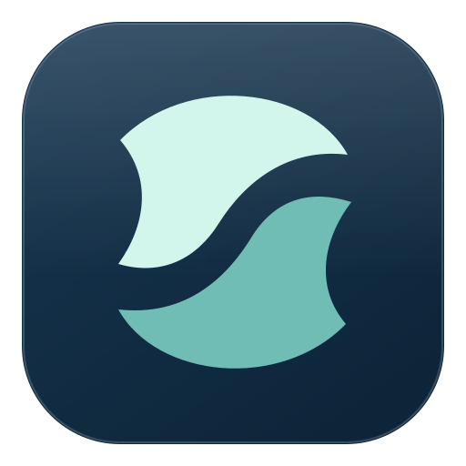

<div align="center">



# 聲聲慢（SpeakSlow）

**本機中文語音輸入：錄音、辨識、整理文字，再貼到游標位置。**

語音辨識可選 Sherpa（sherpa-onnx）或 Apple 原生引擎；文字潤稿可選本機 Ollama 或遠端 AI 服務。

[本 fork](https://github.com/ilovetai1/SpeakSlow) · [最新原始碼（main）](https://github.com/ilovetai1/SpeakSlow/tree/main) · [上游專案](https://github.com/Jeffrey0117/SpeakSlow)

</div>

## 版本與取得方式

這是 `ilovetai1/SpeakSlow` fork 的 **2.1.0 開發版原始碼**。目前包含：

- Apple／Sherpa 本機辨識引擎切換，保留 Sherpa 為預設。
- Ollama 模型選擇、錄音後潤稿、自訂提示詞與歷史重新潤稿。
- 寫作格式、預設關閉的情境潤稿與本機改錯學習，以及按引擎分群的本機延遲統計。
- 手動啟動、可停止且有時間上限的麥克風音量測試。

核心功能已實作並在 Apple Silicon Mac 安裝測試；**完整實機驗收與正式發行尚未完成**。macOS 26 實機、首次權限、跨 App 貼上與人工長口述斷句等限制，請見下方驗證紀錄。

- **取得本次功能**：使用本 fork 的 `main` 分支，或由維護者提供明確從此分支建置的安裝檔。
- **本 fork 安裝檔**：查看 [Releases](https://github.com/ilovetai1/SpeakSlow/releases)。截至 2026-10-14 尚未建立 Release；推送原始碼不會自動產生新版安裝檔。
- **上游安裝檔**：位於 [Jeffrey0117/SpeakSlow Releases](https://github.com/Jeffrey0117/SpeakSlow/releases)，與此分支獨立，不保證包含此 fork 新增的功能。

## 選擇語音辨識引擎

開啟「設定 → 一般設定 → 語音辨識引擎」，選擇引擎並等待顯示「已就緒」。缺模型時，按「下載所需模型」。錄音、辨識、潤稿、保存、貼上與檔案／歷史工作進行中不能切換。

| 項目 | 現有本機引擎（Sherpa） | Apple 原生引擎 |
| --- | --- | --- |
| 預設 | 是 | 由使用者選擇 |
| 平台 | 依 SpeakSlow 對應平台／架構建置；目前主要實測 macOS Apple Silicon | 本版限 macOS 26 以上、Apple Silicon；runtime 目前於 macOS 27.0.1 驗證 |
| 語言與模型 | Paraformer；沿用繁體轉換、熱詞與效能設定 | 固定台灣繁體中文 `zh-TW`，由 Apple 系統管理模型 |
| 標點與排版 | 本機標點模型、依停頓分行與規則列點設定 | 保留 Apple 原生標點；Sherpa 熱詞、分行及列點設定不適用 |
| 共用功能 | 辨識後字典、AI 潤稿、歷史、檔案轉錄與貼上設定 | 同左；尚未提供 Apple 原生熱詞或自訂語言模型 |

Apple 提供兩種辨識偏好：

- **完整上下文（預設）**：保留較完整上下文；短句可能等到停止後才出字。
- **即時回饋**：通常較早顯示可修訂預覽，但可能增加錯字，不保證立即出字。

預覽顯示在 SpeakSlow 內，定稿後才進入共用輸出流程。引擎啟動或辨識失敗會明示錯誤，不自動改用另一引擎或語言。Apple 模型下載屬共享系統服務，停止等待不保證背景下載也停止。

本機配對測試顯示 Apple 的可量測記憶體與 CPU 使用較低，但這批繁中語料的錯字率與斷句沒有優於 Sherpa，因此未改變預設引擎。ANE 活動已觀察到；SDK 排程由 Apple 決定，沒有指定核心數或提高使用率的開關。這些結果不代表已達到 iPhone 體驗。詳見 [Apple 引擎說明](docs/APPLE_ENGINE_IMPLEMENTATION.md)及[辨識、斷句與資源測試報告](docs/APPLE_ENGINE_ACCEPTANCE_2026-10-14.md)。

## 分享給同仁前必讀

**只複製 SpeakSlow App，並不會一併安裝 Ollama 或下載 LLM 模型；Apple 語音模型也需在各台 Mac 檢查及準備。** 語音辨識與 AI 潤稿是兩套不同的功能：

| 要使用的功能 | 同仁電腦需要準備 |
| --- | --- |
| Sherpa 錄音、辨識、貼上 | 對應平台／架構的 SpeakSlow 安裝檔、Sherpa 後端與模型，以及麥克風／貼上權限 |
| Apple 錄音、辨識、貼上 | macOS 26 以上、Apple Silicon 的 SpeakSlow 建置、已就緒的 Apple 模型，以及麥克風／貼上權限；終端使用者不需要 Xcode |
| Ollama 本機潤稿 | 上述條件，加上另外安裝的 Ollama、已下載的本機文字生成模型，以及可連線的本機服務 |
| 遠端 AI 潤稿 | 可用的網路、服務網址、模型與該服務的 API key；文字會送至所選服務 |

未安裝 Ollama 時，可先關閉「潤稿」使用基本辨識。若已開啟潤稿但服務或模型不可用，錄音流程會顯示「潤稿失敗，已使用原始文字」；這代表辨識有結果，**不代表 AI 潤稿成功**。

### macOS 安裝與權限

1. 取得可信來源的安裝檔，安裝為 `/Applications/SpeakSlow.app`。更新時直接替換舊版，只保留一份已安裝 App，不另建舊版備份。
2. 在「系統設定 → 隱私權與安全性」允許麥克風；全域操作與自動貼上需依 App 提示授予「輔助使用」權限。
3. 先關閉潤稿，錄一小段話，確認能辨識並貼到文字編輯器，再設定 Ollama。

目前本機驗證使用 macOS 27.0.1、Apple Silicon Mac。2026-10-14 安裝的測試版使用 **ad-hoc 簽章**，簽章完整性檢查通過；這不是 Developer ID 發行簽章或公證證據。**尚未完成其他同仁電腦的首次安裝驗證**。

若 macOS 顯示無法驗證開發者，請依 [Apple 官方開啟說明](https://support.apple.com/en-us/102445)及公司 IT 規範處理。若顯示「已毀損」，應重新核對安裝檔與簽章，不能直接判定只是系統誤擋。正式分發前應完成 [Developer ID 簽章與公證](https://developer.apple.com/documentation/security/notarizing-macos-software-before-distribution)。

### 麥克風測試與停止收音

「一般設定 → 麥克風音量測試」預設顯示「未啟動」，開啟設定不會自動收音。按「開始測試」才收音，可隨時按「停止測試」；30 秒後、離開分頁或隱藏設定視窗時會停止。再次開啟不會自動重啟。權限頁的「測試麥克風」只檢查權限，完成後立即釋放測試串流。

若無法自動貼上，至「系統設定 → 隱私權與安全性 → 輔助使用」檢查 `/Applications/SpeakSlow.app` 是否已啟用。麥克風授權、辨識成功與目標欄位確實收到文字是三個不同的檢查結果。麥克風問題的修正與驗證範圍見 [診斷紀錄](docs/MICROPHONE_PERMISSION_LEAK_2026-10-14.md)。

## Ollama 本機潤稿設定

### 系統條件

| 平台 | SpeakSlow 自動啟動 Ollama | 使用條件 |
| --- | --- | --- |
| macOS Apple Silicon（M 系列） | 支援，需已安裝 Ollama | 目前已在本機驗證的組合；Ollama 系統需求以官方文件為準 |
| macOS Intel | 不支援自動啟動 | 需先自行啟動 Ollama，另需對應架構的 SpeakSlow 建置；本分支未完成實機驗證 |
| Windows / Linux | 不支援自動啟動 | 需先自行啟動 Ollama，另需對應平台的 SpeakSlow 建置；本分支未完成實機驗證 |

Ollama 的 macOS 系統需求以 [官方文件](https://docs.ollama.com/macos)為準。此分支的 Ollama 連線固定為 `http://127.0.0.1:11434`，目前不支援改用其他電腦或自訂連接埠。

### 第一次設定

1. 從 [Ollama 官方網站](https://ollama.com/download)安裝並啟動 Ollama。macOS 請放在 `/Applications/Ollama.app`，依首次啟動畫面安裝命令列工具。
2. 在同仁自己的電腦下載模型。以下以本專案已測試的 `qwen3:1.7b` 為例：

   ```bash
   ollama pull qwen3:1.7b
   ollama list
   ```

   `qwen3:1.7b` 的大小以[官方模型頁](https://ollama.com/library/qwen3:1.7b)及實際下載顯示為準；下載大小不是執行時記憶體上限。首次下載需要網路與額外磁碟空間，完成後可在本機離線潤稿。

3. 開啟 SpeakSlow 設定，在 AI 設定區把 **Provider** 選為 **Ollama（本機）**，按「重新整理」。
4. 在「本機模型」選擇 `qwen3:1.7b` 或其他已安裝的文字生成模型。**不需要 API key**。模型清單會排除只有 embedding 能力的模型與名稱明確標示 Cloud 的模型。
5. 執行設定頁的連線測試；成功後開啟「潤稿」，儲存設定。可修改「潤稿提示詞」，但不能保存空白提示詞；不需要自行加入逐字稿佔位符。
6. 錄製一段短句，檢查最終文字。歷史紀錄也可重新潤稿，先預覽，再確認取代最終文字。

Ollama 視窗中目前聊天所選的模型，不會決定 SpeakSlow 使用哪個模型；以 **SpeakSlow 設定頁的模型**為準。沒有先前選擇時，程式會優先選取已安裝的 `qwen3:1.7b`，不會自動下載它。

### 服務啟動與資源使用

- SpeakSlow 會先嘗試連接已運行的 Ollama 服務。其他平台只要服務已在上述本機位址運行，也會走相同 API 連線流程，但不等於已完成跨平台實機驗收。
- Apple Silicon Mac 未有服務運行時，會依序尋找 `/opt/homebrew/bin/ollama`、`/usr/local/bin/ollama`、`/Applications/Ollama.app/Contents/Resources/ollama`，再啟動 `ollama serve`。自訂安裝位置不在此搜尋清單時，需自行啟動服務。
- 若 Ollama App 或系統服務尚未啟動，可在終端機執行 `ollama serve` 並保持該程序運行；服務已啟動時不必重複執行。指令依據 [Ollama CLI 文件](https://docs.ollama.com/cli)。
- 程式啟動時不預載 Ollama 模型；選擇 Ollama 會探索模型，連線測試或潤稿才會發出生成請求。
- 逐字稿本機潤稿上限為 **500 個字元**，包含標點、空白及英文字符；超過會回報錯誤，不會自動截斷或分段。生成請求逾時為 **60 秒**，設定頁連線測試為 **20 秒**。
- 每次請求指定模型閒置保留 **10 分鐘**，讓連續錄音減少重載；不會每次潤稿後立即釋放模型記憶體。SpeakSlow 結束時只停止自己啟動的 Ollama 程序。
- 模型輸出仍需人工核對，尤其是姓名、數字、專有名詞及自我修正語句；成功回傳文字不等於內容正確。

### 無法載入時怎麼判斷

| 畫面或現象 | 檢查方式 |
| --- | --- |
| 「找不到 Ollama 執行檔」 | 確認已安裝 Ollama，且位於上述路徑；或先啟動 Ollama App 再重新整理 |
| 「此版本只支援在 macOS Apple Silicon 自動啟動 Ollama」 | 代表目前連不到服務；在該電腦先啟動 Ollama，再重新整理 |
| 模型清單空白／「目前無法使用」 | 用 `ollama list` 核對完整模型名稱；下載所需文字生成模型後重新整理，並重新選取 |
| Ollama 有模型，但 SpeakSlow 連不上 | 確認服務監聽 `127.0.0.1:11434`；可查詢 `http://127.0.0.1:11434/api/tags`，應回傳模型 JSON |
| 「逐字稿超過 500 字的本機潤稿上限」 | 改以較短錄音使用本機潤稿，或關閉潤稿使用辨識結果 |
| 逾時／「潤稿失敗，已使用原始文字」 | 先在設定頁測試模型，檢查記憶體與 Ollama 服務狀態；長文或較大模型可能超過時限 |
| App 本身被 macOS 擋下 | 檢查安裝檔、簽章、公證與系統權限；這發生在 Ollama 功能載入之前 |

## 主要功能

- **可選本機辨識**：Sherpa Paraformer 與 Apple SpeechAnalyzer／SpeechTranscriber；辨識後可套用自訂字典。
- **文字整理**：依引擎使用 Sherpa 標點／規則或 Apple 原生標點；另可選用 AI 潤稿。
- **寫作與學習**：寫作格式、預設關閉的本機情境潤稿與待核准改錯候選。
- **延遲觀測**：依 ASR 引擎／偏好與 LLM provider 分群，區分首次預覽、停止到辨識定稿與貼上命令 ACK。
- **鍵盤操作**：開始／停止錄音、`Esc` 取消、自訂快捷鍵，以及個別功能啟用開關。
- **自動貼上**：依設定把最終文字貼到完成時的游標位置，可控制是否自動送出。
- **歷史紀錄**：搜尋、統計、匯出、重新辨識，以及保留辨識原文的重新潤稿預覽。
- **音訊／影片匯入**：手動轉錄，編輯結果後匯出 TXT 或 SRT。

辨識和潤稿的速度取決於音訊、模型、硬體與是否需要冷啟動，不以固定秒數作保證。

## 資料與隱私

- **兩種語音辨識引擎**在裝置端執行；模型首次下載需要連網。Apple 選項不代表另開的雲端 AI 潤稿也在本機。
- **選用本機 Ollama 模型潤稿**時，SpeakSlow 將文字送至本機 loopback API，不會在潤稿失敗後自動切換到遠端 AI。此功能不支援 Ollama Cloud；程式自行啟動的 Ollama 服務會禁用 Cloud，既有外部服務的設定仍由使用者管理。
- **選用 DeepSeek、OpenAI、Gemini 或自訂遠端服務**時，待處理文字會送到該服務，隱私與費用依供應商條款。因此「語音辨識在本機」不能等同「所有設定下文字都不上雲」。
- 情境潤稿與被動改錯預設關閉；本機文字情境僅供 Ollama 使用。改錯候選需核准才成為字典規則。延遲資料不含文稿／PCM，保留 7 天、最多 1000 筆。
- 操作模式的 Edge TTS 朗讀是線上功能；本機語音辨識不代表朗讀離線。
- 設定、歷史與保存的錄音位於使用者資料目錄，不隨 Git 原始碼分享；同仁需設定自己的模型與服務。分發時應使用建置產物。

## 開發者：從原始碼執行

使用 **Node.js 20.11 以上**（native helper 建置腳本使用 `import.meta.dirname`）、**Python 3.11**（CI 建置版本）及 npm。`npm ci` 的 postinstall 會為 Electron 準備原生模組；若需編譯，須有平台的編譯工具。

```bash
git clone --branch main https://github.com/ilovetai1/SpeakSlow.git
cd SpeakSlow
npm ci
```

macOS 另需 Xcode／Command Line Tools 與可編譯 macOS 26 `SpeechAnalyzer` API 的 SDK；本機使用 SDK 27 建置。開發模式首次使用 native helper 前，先執行 `npm run build:context` 與 `npm run build:apple`。這是開發者的建置需求，終端使用者不需要安裝這些工具。

macOS / Linux：

```bash
python3.11 -m venv .venv
source .venv/bin/activate
python -m pip install sherpa-onnx numpy opencc edge-tts pyinstaller
python download_all_models.py
npm run dev
```

Windows PowerShell（需已安裝 Python 3.11）：

```powershell
py -3.11 -m venv .venv
.\.venv\Scripts\Activate.ps1
python -m pip install sherpa-onnx numpy opencc edge-tts pyinstaller
python download_all_models.py
npm run dev
```

語音模型存放在專案的 `poc-sherpa` 目錄，模型大檔不在 Git 中。`download_all_models.py` 下載 Paraformer、Paraformer-small、INT8 標點、Zipformer 與 Silero VAD，**不會下載 Ollama 或 Qwen**。若要測試本機潤稿，仍需完成前述 Ollama 設定。

### 建置安裝檔

先在目標作業系統／架構準備依賴與語音模型，再依序執行：

```bash
npm run build:backend
npm run build:renderer
```

然後選擇該平台的打包指令：

| 平台 | 指令 |
| --- | --- |
| macOS Apple Silicon | `npx electron-builder --mac --arm64 --publish never` |
| Windows | `npx electron-builder --win --publish never` |
| Linux | `npx electron-builder --linux --publish never` |

macOS 的 `build:renderer` 會先編譯 context reader 與 Apple speech helper；非 macOS 會跳過這兩個 helper。`npm run build:mac` 也會依序重建 backend、renderer 再打包，避免使用舊 backend。Apple helper 的 deployment target 為 macOS 26；這不等於已在 macOS 26 實機驗收。

產物位於專案的 `dist` 目錄。macOS 建置另包含原生 helper；Apple 語音模型由系統管理，不隨 App 內嵌。正確建置的安裝檔包含 PyInstaller 語音後端、Paraformer／Paraformer-small、INT8 標點模型與 VAD；Ollama 程式與 LLM 模型仍需另外安裝。串流 Zipformer 與 Whisper 不在目前 `extraResources` 預載清單中。

macOS 預設打包未配置 Developer ID 發佈簽章／公證；完成打包不代表可直接供所有同仁安裝。一般分支 push 也不會觸發現有 macOS／Linux 發佈工作流程，其觸發條件為手動執行或 `v*` tag。

### 驗證

```bash
node --test --test-concurrency=1 test/*.test.js
python -m unittest discover -s test -p 'test_sherpa_memory.py' -v
npm run build:renderer
```

2026-10-14 最新 Node 回歸為 **133 項：131 通過、2 跳過**；這是該次程式狀態的結果，不代表所有發行驗收通過。既有 `npm run lint` 因 ESLint 9 缺 flat config 而無法執行，尚未修正。

SQLite 測試在一般 Node 環境可能因 Electron ABI 跳過，需用相符的 Electron runtime 另行驗證。自動測試與 renderer 建置不能替代其他同仁電腦的首次安裝、權限、真實錄音及 Ollama 測試。

## 技術棧

- React 19、Tailwind CSS、Vite、Electron。
- sherpa-onnx、Paraformer、Silero VAD、ct-transformer INT8；另支援 Whisper 與 Zipformer。
- Apple SpeechAnalyzer／SpeechTranscriber、Swift helper 與 AVAudioConverter。
- Ollama 原生本機 API，以及 OpenAI 相容服務 API。
- better-sqlite3、uiohook-napi；Python 後端透過 PyInstaller 打包。

## 文件與驗收範圍

| 文件 | 內容 |
| --- | --- |
| [Apple 引擎使用與維護](docs/APPLE_ENGINE_IMPLEMENTATION.md) | 引擎選擇、資產、失敗重試、連續音訊與 helper 建置 |
| [Apple 引擎驗收報告](docs/APPLE_ENGINE_ACCEPTANCE_2026-10-14.md) | 240 筆辨識、繁中 CER、腳本斷句、速度、physical footprint、CPU 與 ANE 的範圍與限制 |
| [麥克風問題診斷](docs/MICROPHONE_PERMISSION_LEAK_2026-10-14.md) | 權限測試釋放、手動音量監測與尚未完成的成對實機確認 |
| [寫作、學習與延遲實作](docs/EVOLUTION_2_1_0_IMPLEMENTATION.md) | 寫作格式、本機情境與改錯候選使用方式 |
| [寫作與學習驗證](docs/EVOLUTION_2_1_0_VALIDATION.md) | TextEdit 部分實機證據與 Chromium 等剩餘限制 |

檔案提交到辨識完成，不等於麥克風停止到貼上；貼上命令 ACK 也不代表目標程式已接收。合成語料的腳本標點 F1 不能代替真人口述的人工斷句驗收。完整剩餘任務見 [Apple 引擎 change](openspec/changes/add-switchable-apple-speech-engine/tasks.md)與[寫作／學習 change](openspec/changes/add-context-learning-and-latency-metrics/tasks.md)。

## 後續工作

- [x] 原生 Ollama 模型探索、選擇與 Apple Silicon 按需啟動。
- [x] 可編輯的共用潤稿提示詞，以及歷史重新潤稿預覽。
- [x] Apple／Sherpa 選擇、Apple 兩種偏好與共用轉錄流程。
- [x] 麥克風測試手動啟動、停止及隱藏時釋放。
- [ ] macOS 26 實機、真人長口述斷句與跨 App 停止到貼上的完整驗收。
- [ ] Ollama 與模型的整合安裝引導／一鍵下載。
- [ ] 本 fork 的安裝檔發佈、macOS Developer ID 簽章與公證。
- [ ] 在其他同仁電腦及 Windows／Linux 完成首次安裝驗證。

## 🤝 貢獻

歡迎 issue / PR！這是給中文使用者的工具，你的回饋就是方向。

### 程式碼貢獻者

[](https://github.com/Jeffrey0117/SpeakSlow/graphs/contributors)

### 社群回饋 🙌

感謝這些朋友的回報、建議、修法與實測，把產品一點一點推得更好：

[@webeasyplay](https://github.com/webeasyplay) · [@yhlhenry](https://github.com/yhlhenry) · [@MeteorVE](https://github.com/MeteorVE) · [@adamjwchen](https://github.com/adamjwchen) · [@Drava008](https://github.com/Drava008) · [@NaotoSama](https://github.com/NaotoSama) · [@m45801ch](https://github.com/m45801ch) · [@jaylooloomi](https://github.com/jaylooloomi) · [@artexwear](https://github.com/artexwear) · [@RYN6666999](https://github.com/RYN6666999) · [@Skywalker95241](https://github.com/Skywalker95241) · [@dick922](https://github.com/dick922) · [@GenKoKo](https://github.com/GenKoKo)

## 🙏 致謝

- [ququ (yan5xu/ququ)](https://github.com/yan5xu/ququ)：原始專案，本專案在其基礎上改用 sherpa-onnx 引擎並重做 UI 與互動。
- [sherpa-onnx (k2-fsa)](https://github.com/k2-fsa/sherpa-onnx)：本地語音辨識引擎。
- [Wispr Flow](https://wisprflow.ai/)：產品概念的啟發。

## ⭐ Star History

如果聲聲慢對你有幫助，給顆星支持一下，這是最實際的鼓勵 🌟

<a href="https://www.star-history.com/#Jeffrey0117/SpeakSlow&Date">
  
</a>

<sub>點圖看即時曲線</sub>

## 📄 授權

本專案採用 [Apache License 2.0](LICENSE)。
