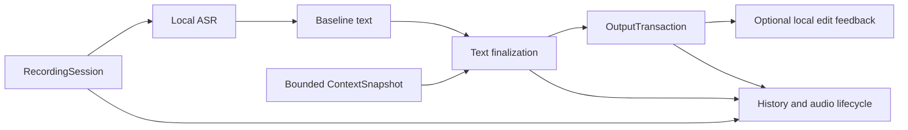

# Typeless macOS 逆向評估與 SpeakSlow 進化方向

評估日期：2026-10-13（Asia/Taipei）。對象：官方 Typeless 2.8.2 / build 2.8.2.131，Apple Silicon 安裝包。SpeakSlow 基準為本次工作目錄，包含既有未提交修改。

## 結論

SpeakSlow 最值得進化的是「完整的語音輸入工作流程」：可靠輸出、可取消的 session、可控情境、改錯回饋、可恢復歷史。現有本機 sherpa-onnx 與 Ollama 可保留；本次沒有證據支持為了追上 Typeless 而重寫整個 Electron app。

已確認 Typeless 也使用 Electron，另外以 Swift 原生 helper 處理 context、輸入、鍵盤與音訊。其優勢可學成小型介面與產品契約，逐步接入現有 SpeakSlow。

| 優先 | 可進化部分 | 本次判斷 |
|---|---|---|
| P0 | 輸出交易：目標、接收狀態、Enter、剪貼簿 | SpeakSlow 將 Cmd+V 派送成功當成貼上完成；Typeless 的已分析 native insertion 也沒有接收確認。這是本專案應自行補強的品質要求。 |
| P1 | 錄音 session 與取消 | 停止錄音後，SpeakSlow 的 Esc 不取消一般 ASR／潤稿。可借用 Typeless 的 request ID／AbortController 概念，再建立全流程結果失效契約。 |
| P1 | App／欄位情境與可選寫作模式 | Typeless 有 app、欄位能力、選取、游標前後文與 context quality。SpeakSlow 自動潤稿目前主要只收到 transcript。 |
| P1 | 本機改錯學習與有範圍的詞庫 | Typeless 會追蹤目標欄位內的小幅修改。SpeakSlow 已有面板改錯記憶，但字典是全域替換。 |
| P1 | 歷史、重試、音檔與留存的一致性 | Typeless 的 history 是帶 status、metadata 和重試資訊的工作紀錄。SpeakSlow 有救援／重辨，但保存和刪除仍有缺口。 |
| P2 | 可測量的延遲與模式一致性 | 先量測各階段，再決定 AudioWorklet、buffer、模型或 native helper 的投入。不能以官網速度宣稱替代 benchmark。 |

## 證據範圍與限制

- REA MCP 已實際使用，版本 6.4.0；Ghidra provider 可用。
- 官方 [Downloads](https://www.typeless.com/downloads) 的 Apple Silicon 下載入口，當次導向 [Typeless-2.8.2-arm64.dmg](https://typeless-static.com/desktop-release/Typeless-2.8.2-arm64.dmg)。DMG 為 190,827,043 bytes；SHA-256：`47152eafa9d3fc13d6276bbb2d2ecec61f670c08631e96f09a5c225885ccd24d`。
- 應用 bundle ID 為 `now.typeless.desktop`。REA 觀察到 Developer ID Application: Simply LLC，Team ID `947QKAND4W`，hardened runtime。另以 `codesign --verify --deep --strict` 驗證複製出的 app，結果為 valid on disk / satisfies its Designated Requirement。這不是獨立的安全審計或 notarization 驗證。
- ASAR SHA-256：`49ee4061c662c4284e1d79327e2b0c4389d2df1fc1de9004e252e6e6f8528ad9`。REA 解析 6,006 個 JavaScript 檔；graph coverage 為 **partial**。混淆 main bundle 的 semantic analysis 超出 1 GiB worker heap；其他 dynamic channel、semantic budget 與 parse failures 仍有未知。
- `better_sqlite3.node` 與 `koffi.node` 的解包檔雜湊不符 ASAR 宣告。採 `record-and-continue` 保留 observed-untrusted 標記；签章驗證通過仍不能證明此差異的原因。
- 另以 literal parser 解讀 main bundle 的字串表與 rotation，對選定 call paths、SQL migration 做靜態核對；未執行 target JavaScript。
- 原生 input helper 為 universal Mach-O；以 `lipo -thin arm64` 產生分析副本，再由 REA／Ghidra反編譯四個相關函式。原始 artifact 未改寫。
- 沒有安裝至 `/Applications`、登入、啟動 Typeless、錄音、上傳資料或量測實際延遲。本次是**有界的靜態逆向評估**。

完整機器證據在忽略目錄內：[REA 摘要](/Users/chunghan/AI/SpeakSlow/.local/rea-typeless-2026-10-13/rea-summary.json)、[canonical Evidence bundle](/Users/chunghan/AI/SpeakSlow/.local/rea-typeless-2026-10-13/rea-evidence.json)、[獨立靜態 findings](/Users/chunghan/AI/SpeakSlow/.local/rea-typeless-2026-10-13/static-data-audit/findings.json)。canonical bundle 約 317 MB；一般閱讀先用摘要。報告不內嵌競品程式碼。

## 1. 可靠輸出：最先處理

**Typeless 已確認。** JS wrapper 綁定 native `insertText`、`insertRichText`、`getCurrentInputState`。Ghidra 反編譯的 `performTextInsertion`（arm64 `0x6914`）先保存 pasteboard，再寫入文字與 transient 類型，呼叫 `simulatePasteCommand`，最後回傳 true。`simulatePasteCommand` 將工作排到 main queue。這個函式的成功回傳不是目標文字接收確認。

`savePasteboard` 與 `ArchivedPasteboardItem.init` 會遍歷 pasteboard items，按各 type 讀取 data。這是比純文字備份更完整的結構；實際各格式還原成功率尚未測試。

**SpeakSlow 已確認。** [clipboard.js:371](/Users/chunghan/AI/SpeakSlow/src/helpers/clipboard.js:371) 只用 readText 保存剪貼簿。[clipboard.js:429](/Users/chunghan/AI/SpeakSlow/src/helpers/clipboard.js:429) 在 osascript exit 0 時 resolve，並明確記錄尚未確認目標接收。[App.jsx:746](/Users/chunghan/AI/SpeakSlow/src/App.jsx:746) 使用 current target；其後設定 pasteSucceeded=true，若自動 Enter 開啟就送 Enter。操作模式另有分支，不適用此一般輸出判斷。

**建議。** 建立 OutputTransaction：捕捉目標與可編輯能力、明確遵循既有 current target 政策、派送、可觀察 read-back、回報 sent／confirmed／unconfirmed／failed。不能 read-back 的 app 應顯示未確認，保留可取回的結果。將自動 Enter 與確認結果連結。保存多格式剪貼簿，並避免覆蓋使用者在交易期間新複製的內容。

**最小驗收。** 普通 textbox、contenteditable、唯讀來源、焦點切換、圖片／HTML 剪貼簿、使用者中途複製新內容。結果只能插入一次；不能以按鍵送出宣稱已接收。自動 Enter 只在符合新的明確產品契約時執行。

## 2. 一次錄音是一個可取消的 session

**Typeless 已確認。** main bundle 的 AI voice-flow handler 以 abortId 管理 AbortController，request 前後檢查 aborted，並提供 `audio:abort-ai-voice-flow-request`。未追完整 renderer 狀態機；不能據此宣稱所有取消都阻止所有副作用。

**SpeakSlow 已確認。** 已有 single-flight gate、錄音取消、precog abort、潤稿關閉／shutdown abort。惟 [App.jsx:1193](/Users/chunghan/AI/SpeakSlow/src/App.jsx:1193) 只在 isRecordingNormal 為 true 時處理 Esc；[useRecording.js:528](/Users/chunghan/AI/SpeakSlow/src/hooks/useRecording.js:528) 沒有一般 ASR／潤稿的 session 結果失效檢查。

**建議。** 以 session ID 串起 preparing → recording → transcribing → polishing → output → completed。各階段在產生 UI、歷史、paste、Enter 副作用前檢查 session 是否有效。真正停止後端計算另需取消協議；只加 session ID 只能拒絕過期結果。

**最小驗收。** 延後 getUserMedia、ASR 與 AI 回覆，分別按 Esc；舊結果不得再貼上或送 Enter。立刻開始下一次錄音，新結果只輸出一次。已保存原文及取消後是否留歷史須先定義，不能悄悄改變既有契約。

## 3. 可控的 context，而非只有一段 transcript

**Typeless 已確認。** `collectFullContext` 先準備 Accessibility，讀 focused app，再並行收集 app 與 input context。資料結構包括 app/window/browser、editable capabilities、選取、游標前後文、full field、surrounding context、品質與 capture duration。原生 context helper 有相關 AX 入口。實際跨 App 成功率與敏感欄位排除仍 `unclear`；分析片段中的 blacklist 並未全面阻止每種 cursor-state 讀取。

**SpeakSlow 已確認。** [aiPrompts.js:1](/Users/chunghan/AI/SpeakSlow/src/helpers/aiPrompts.js:1) 已處理贅詞、自我修正、繁中、中英混用與原意保留；[aiPrompts.js:29](/Users/chunghan/AI/SpeakSlow/src/helpers/aiPrompts.js:29) 自動潤稿只包 transcript。操作模式已有選取內容處理，[commandMode.js:192](/Users/chunghan/AI/SpeakSlow/src/helpers/commandMode.js:192)，所以不能說整個專案沒有 context。

**建議。** 先提供使用者可選的「逐字／整理、訊息／郵件／筆記」政策，再接入小型 ContextSnapshot 介面。預設只傳使用者選定模式及必要 app 資訊；讀取鄰近文字另設可見、可停用的選項，排除密碼欄位與指定 app／網站。本機可用資料不代表應全部放入 prompt。

SpeakSlow 可以保留 Electron，以窄的 macOS native helper 取得欄位能力與 bounded context，無需立即重寫 React／Python／ASR。另應區分「改寫選取文字」與「解釋選取文字」的結果路由：前者取代選取，後者呈現答案。這是 [Typeless Ask anything](https://www.typeless.com/help/quickstart/ask-anything) 官方描述的互動，尚未於本機驗證。

**最小驗收。** 相同口述在訊息與郵件模式得到不同排版但相同意思；context 失效或不可讀時明確顯示其可用狀態。用數字、日期、否定、ECOCO、人名與技術詞語料，驗證不新增資訊、不改原意。

## 4. 改錯學習：從面板走到真正輸入欄位

**Typeless 已確認。** edit tracking 開始前，讀回 editable field 並確認欄位包含 refined text；保存 input_box_identifier。短時間追蹤小幅改動，焦點／欄位變化則停止，最大追蹤時間為 15 秒。main 存在送往 `/user/traits` 的 call path，準備原始／修改後欄位、插入文字與 app context；回應可包含 auto_add_dictionary，接著發送 word-auto-added 事件。

這是 shipped-code path；本次未觀察實際傳送、consent、storage、服務端模型或學習成效。read-back 是 tracking 啟動條件，不能當成所有輸入的接收驗證。官方 [Personalization](https://www.typeless.com/help/quickstart/personalization) 對抽象風格及零留存的敘述，是服務政策宣稱，靜態 client 分析不能驗證雲端留存。

**SpeakSlow 已確認。** [App.jsx:828](/Users/chunghan/AI/SpeakSlow/src/App.jsx:828) 已有面板改錯記憶。[database.js:179](/Users/chunghan/AI/SpeakSlow/src/helpers/database.js:179) 以全域、忽略大小寫的字串替換套用所有啟用字典項目；分類目前沒有參與套用範圍。

**建議。** 先做 opt-in 的本機 edit feedback：只追蹤本次插入的有限範圍，產生可查看／拒絕／撤回的候選詞。詞庫加 app／專案範圍與來源。將「專有名詞提示」和「永久字串替換」分開；同音歧義不能一次更正就映射到全部情境。初期手動的 ECOCO／商務／工程詞庫，比自動監看所有內容容易驗收。

**最小驗收。** ECOCO、人名、縮寫的更正可形成候選；一般句意重寫不自動建立詞條。切換欄位即停止追蹤。關閉學習後沒有新的捕捉或詞條。

## 5. 可恢復歷史與清楚的留存契約

**Typeless 已確認。** [history_v2 SQL](/Users/chunghan/AI/SpeakSlow/.local/rea-typeless-2026-10-13/Typeless.app/Contents/Resources/drizzle/0011_pretty_magik.sql:1) 有 status、audio metadata、mode metadata、context。後續 migration 有同步狀態與 attempt count。main 的本機刪除路徑包含音檔 unlink 和 row deletion；有週期性 history／disk cleanup。這些是 schema 與 code path，實際設定、失敗／競態與雲端行為未測。

**SpeakSlow 已確認。** 已有崩潰救援、原音重辨、歷史潤稿預覽、保存錄音開關與保留天數。需深化：

- [useRecording.js:334](/Users/chunghan/AI/SpeakSlow/src/hooks/useRecording.js:334) 在 ASR 前 cleanup，透過非 await IPC 要求刪除 recovery；不能宣稱瞬間已刪完。[recovery.js:40](/Users/chunghan/AI/SpeakSlow/src/helpers/recovery.js:40) 會 unlink 暫存。
- [sherpaManager.js:914](/Users/chunghan/AI/SpeakSlow/src/helpers/sherpaManager.js:914) 背景保存先回傳目的路徑；copy 失敗只寫 warning，仍清除 ASR 暫存。可能留下不存在的 audio_path，尚未用實際失敗案例驗證。
- [database.js:313](/Users/chunghan/AI/SpeakSlow/src/helpers/database.js:313) 刪歷史只刪 row；相應 IPC 沒有音檔刪除。
- [useRecording.js:391](/Users/chunghan/AI/SpeakSlow/src/hooks/useRecording.js:391) 先套字典，之後存 raw_text；此欄位不是 untouched ASR output。
- [sherpa_server.py:1145](/Users/chunghan/AI/SpeakSlow/sherpa_server.py:1145) 會記串流文字；一般完成日誌也記錄文字片段。關閉永久音檔保存，不等於沒有 recovery／日誌留存。

**建議。** 歷史保存 session status、最後成功階段、可重試原因、audio 保存狀態；明確分開 ASR 原始輸出、基線、潤稿版本與使用者修訂。只有音檔落地完成才能標記已保存。將 recovery、永久音檔、文字歷史、日誌各自的留存與刪除契約列明；保留使用者選擇的 no-save 行為。DB schema 變更屬後續提案，本次未做 migration。

**最小驗收。** ASR 中／保存中模擬崩潰、copy 拒絕、ASR 失敗、歷史刪除、關閉保存。狀態必須真實；需要保留的音訊可恢復；已刪除範圍與 UI 說明相符。

## 6. 效能先量測，再換架構

**Typeless 已確認。** context 有 total_capture_duration_ms；Opus workers 有 native／JS encoding time、real-time ratio、input／output size 與 compression ratio。client 具有 Opus 分塊編碼入口，但這不證明串流 ASR 協議、離線辨識或更低延遲。

**SpeakSlow 已確認。** 已有 precog、ASR RTF 與 AI duration。惟 [system IPC:216](/Users/chunghan/AI/SpeakSlow/src/helpers/ipc/system.js:216) 的 performance stats 仍回空資料。[useRecording.js:224](/Users/chunghan/AI/SpeakSlow/src/hooks/useRecording.js:224) 用 ScriptProcessor 累積 PCM。一般串流完成直接貼上，[App.jsx:786](/Users/chunghan/AI/SpeakSlow/src/App.jsx:786)，並未共用離線潤稿流程。

**建議。** 使用同一 session ID 量測 key→capture、stop→ASR、polishing、派送與可確認接收的 P50／P95，以及啟動／長錄音記憶體。補齊不同錄音模式的字典、潤稿、麥克風、保存與 duration 契約。之後再實驗 AudioWorklet、有界 buffer、pipeline overlap 或 native capture。

本機潤稿目前有 500 字限制，[aiTextProcessor.js:133](/Users/chunghan/AI/SpeakSlow/src/helpers/aiTextProcessor.js:133)。長稿可研究分段與有限前後文，但必須先有原意保留語料測試。較大的模型或新的 prompt，不等於已解決數字、人名與自我修正。

## 實作順序與建議介面

1. OutputTransaction＋session 結果失效；處理 Enter、焦點、剪貼簿與取消。
2. History／audio 保存狀態、恢復與刪除契約。
3. 使用者可選的寫作 profile＋ContextSnapshot；先驗證本機語料品質。
4. 有範圍的字典＋可撤回的本機改錯候選。
5. 延遲／記憶體數據驅動的 capture 與模型優化。

下圖是**建議設計**，不是 Typeless 的完整還原：

## 未解與不應推論的部分

- Typeless 的服務端 ASR／LLM 型號、prompt、personalization algorithm 與資料留存實際執行 `unclear`。
- 官網 [Data controls](https://www.typeless.com/data-controls) 明示 cloud processing，並新增 optional history cloud sync；「on-device history」不能解讀成離線 ASR，也不能套用為所有同步設定的現況。SpeakSlow 的本機 ASR／Ollama 是可保留的差異。
- 未做兩套 app 的同音訊準確率、插入成功率、P95 延遲、記憶體或耗電比較。
- 未取得完整 renderer recording state-machine 證據；不能將 main 的 abort handlers 或 history schema 說成完整 session 驗證。
- 原生 helper 的 symbols／反編譯只證明選定實作與結構，不證明跨 App 相容性、權限成功或 runtime reachability。
- 本次新增評估文件與忽略目錄中的分析資料；沒有改產品程式碼、commit、push、部署或 migration。

## REA Evidence 索引

| 觀察 | Evidence ID |
|---|---|
| app 簽章與 hardened runtime | `ev_73305e6e0fdfbde5b5457ac214d360a983cd5f0e30d90a9817572818125c2732` |
| ASAR application graph，partial coverage | `ev_d9b0e7c46aa1787803f6f10c9246a2e62d0fbcd5042c94a04195c223caf8db73` |
| arm64 input-helper Mach-O exports | `ev_ca08d60e05759322026029ba5e2b23b719889a68c2343cc69671b3911f72b16f` |
| performTextInsertion @ 0x6914 | `ev_eb7de3c56fce4b991bd725aa0873530482ff9db0e28e6995304e0ffa37aedf57` |
| simulatePasteCommand @ 0x8738 | `ev_31d1dca06be2d16ba5213c62ed8276c48e19c221f15bae44ecaa2d768486f754` |
| savePasteboard @ 0x82d8 | `ev_15a96b8c9287a817e1af41cd846e657090a2afb55b58af3a53998e720ac367f5` |
| ArchivedPasteboardItem.init @ 0xbb24 | `ev_157ebad9ad7725f5bdc86c0b5fc6d925f70605c9c39ef10faf2a149f4a98e969` |

main／worker 靜態 call paths 另外列於 findings.json，附原始檔 SHA-256 與 UTF-8 byte offsets；不冒充 REA 的完整 semantic 證據。
